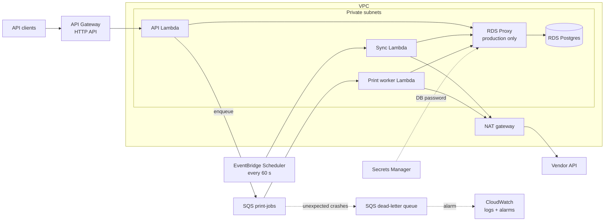
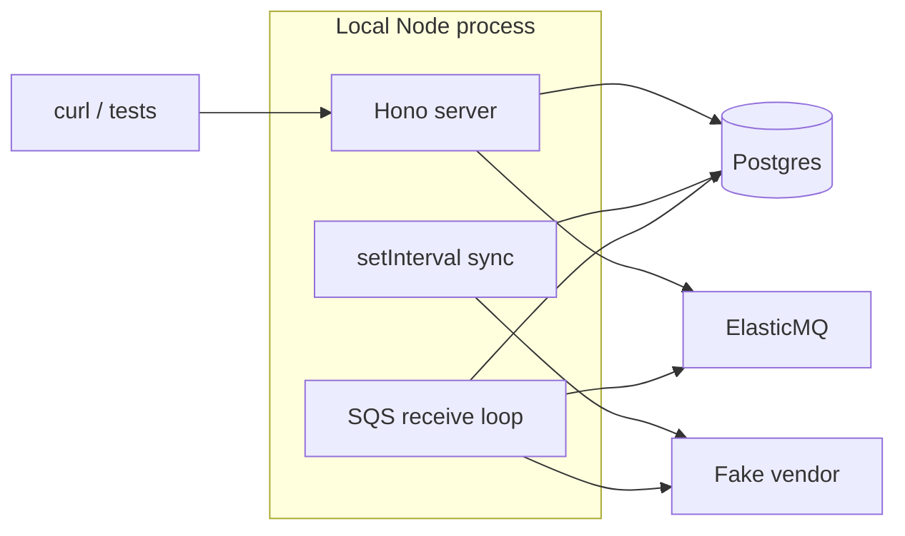

# Architecture

Decisions behind this architecture are in [ADR 0002](adr/0002-aws-serverless-with-local-node.md).

## AWS

| Component | Responsibility |
|---|---|
| API Lambda | Hono app: list printers and labels, update metadata, accept print jobs |
| Sync Lambda | Fetch printers and labels from the vendor and combine them with our data in one transaction |
| Print worker Lambda | Send queued jobs to the vendor, sort errors into retryable or final, update job status |
| SQS `print-jobs` | Buffers print jobs and drives retries and backoff |
| RDS Postgres | Printers, labels, metadata, print jobs, sync state |
| RDS Proxy | Pools connections from many Lambdas (production only) |
| NAT gateway | Lets the Lambdas in the VPC reach the vendor |

## Local

Postgres and ElasticMQ run in `docker-compose`. The Lambdas and the local process call the same modules; only the triggers differ.
