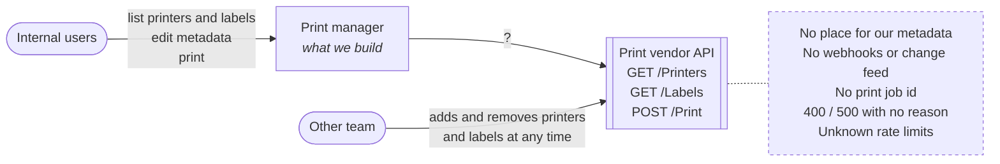
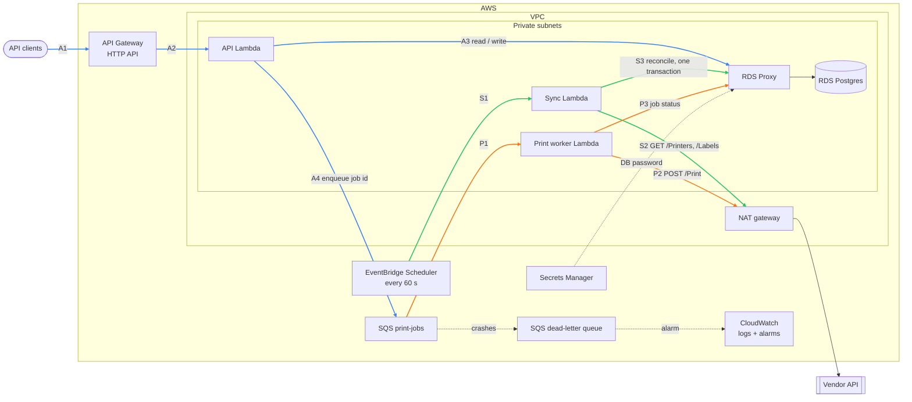
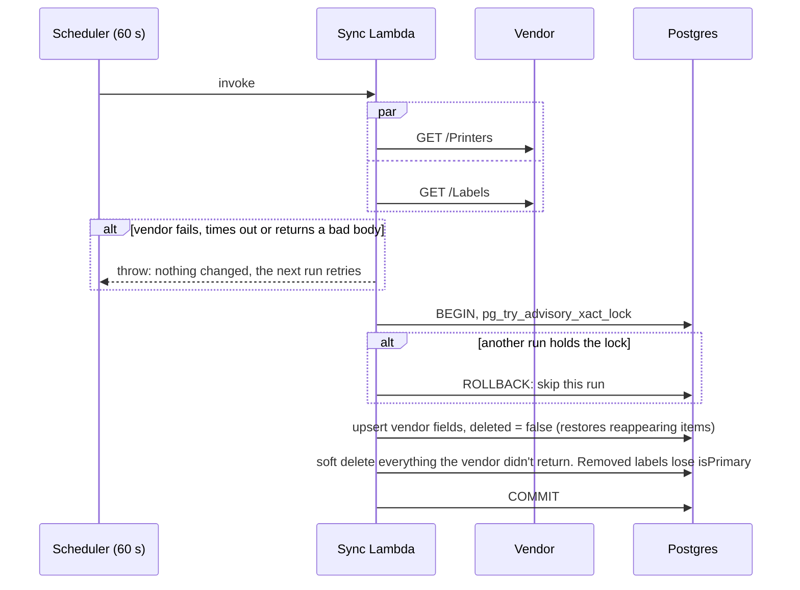
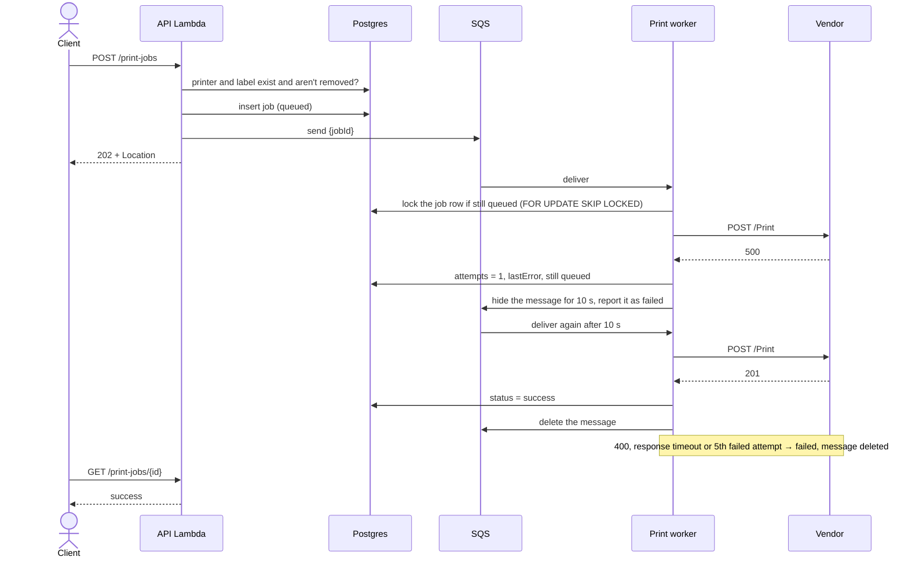

# Design

A REST API for printing labels remotely, in front of a third-party print vendor.

1. [Problem](#1-problem)
2. [Solution](#2-solution)
3. [API](#3-api)
4. [Key decisions](#4-key-decisions)
5. [How consistency is guaranteed](#5-how-consistency-is-guaranteed)
6. [Implemented vs. designed, not built](#6-implemented-vs-designed-not-built)
7. [Trade-offs and known limitations](#7-trade-offs-and-known-limitations)
8. [Future work and reflections](#8-future-work-and-reflections)

## 1. Problem



Users need one REST API to:

- list printers, and update their metadata (nickname, location, serial number)
- list labels, and update their metadata (nickname, `isPrimary`)
- submit a print job to a printer

The vendor gives one print API across printer models, but only exposes names, models and label versions:

| Endpoint | Returns / accepts | Notes |
|---|---|---|
| `GET /Printers` | `[{name, model}]` | no id, no pagination |
| `GET /Labels` | `[{id, name, version}]` | no pagination |
| `POST /Print` | `{printerName, labelId}` | `201` / `400` / `500`, no job id, no error reason |

Another team adds and removes printers and labels at the vendor without telling us. **Our API must be consistent, or eventually consistent, with the vendor.**

Out of scope: changing printers and labels at the vendor, designing labels, knowing whether a label physically printed (the vendor doesn't say), and authentication.

## 2. Solution

Keep our own copy of the vendor's printers and labels, refreshed every 60 s, with our metadata next to it. Send print jobs through a queue, so a slow or failing vendor never blocks a client.



There are three flows: **A** for API requests (blue), **S** for sync (green) and **P** for printing (orange).

| Component | Responsibility | Code |
|---|---|---|
| API Lambda | List printers and labels, update metadata, accept print jobs | `src/routes/`, `src/lambda/api.ts` |
| Sync Lambda | Read the vendor and reconcile our store with it in one transaction | `src/sync.ts`, `src/lambda/sync.ts` |
| Print worker Lambda | Send jobs to the vendor, sort errors into retryable or final, record status | `src/print-jobs.ts`, `src/print-worker.ts` |
| SQS `print-jobs` | Buffers print jobs and drives retry backoff. A dead-letter queue catches crashes | `src/queue.ts` |
| RDS Postgres | Printers, labels, metadata and print jobs | `src/db/schema.ts` |
| RDS Proxy | Pools connections from many Lambdas. Production only | |
| NAT gateway | Lets Lambdas in private subnets reach the vendor | |

All vendor calls go through one `VendorClient` (`src/vendor.ts`), which tests replace with an in-process fake vendor.

**Locally**, one Node process (`src/local.ts`) runs the same modules: the Hono server, a sync loop, and an SQS receive loop. Postgres and ElasticMQ (an SQS-compatible server) run in `docker-compose`. Only the triggers differ from AWS. See the [README](../README.md).

## 3. API

Swagger UI at `/docs` and `/openapi.json` hold the full schema, generated from the Zod schemas in code.

| Route | Success | Errors |
|---|---|---|
| `GET /printers` | `200` | |
| `GET /printers/{name}` | `200` | `404` |
| `PATCH /printers/{name}` | `200` + updated printer | `400`, `404` |
| `GET /labels` | `200` | |
| `GET /labels/{id}` | `200` | `404` |
| `PATCH /labels/{id}` | `200` + updated label | `400`, `404` |
| `POST /print-jobs` | `202` + `Location` | `400`, `422`, `503` |
| `GET /print-jobs/{id}` | `200` | `404` |

Vendor fields are read-only and sit at the top level. Our fields sit under `metadata`:

```json
{
  "name": "ZD420-HALL-B",
  "model": "ZD420",
  "metadata": { "nickname": "Hall B left", "location": "Building 2, Hall B", "serialNumber": null }
}
```

- Lists are plain arrays, without pagination. Removed printers and labels are left out, and return `404`.
- `PATCH` takes a partial `metadata` object. A missing field means no change, and `null` clears a field. Unknown fields, including vendor fields, get `400`.
- Setting `isPrimary: true` on a label clears it on the other versions with the same `name`.
- `POST /print-jobs` returns `422` when the printer or label doesn't exist or has been removed, and `503` when the job couldn't be queued.
- Errors are [RFC 9457](https://www.rfc-editor.org/rfc/rfc9457) `application/problem+json`.

| Job status | Meaning |
|---|---|
| `queued` | Accepted, waiting to be sent or being retried |
| `success` | The vendor returned `201`. That doesn't mean the label physically printed |
| `failed` | The vendor returned `400`, the response timed out, retries ran out, or the job couldn't be queued |

## 4. Key decisions

We can't reach the stakeholders, so each open question gets an explicit assumption.

| Question | Assumption | Choice |
|---|---|---|
| How is a printer identified? | `name` is unique and stable. A rename is a delete plus an add | `name` is the key, in the database and in URLs |
| How is a label identified? | `id` is unique and stable. A new version gets a new `id` and keeps the `name` | `id` is the key |
| Who owns which data? | The vendor owns existence and vendor fields. We own metadata | Sync writes only vendor fields. The API writes only metadata |
| How do we learn about vendor changes? | No webhooks or change feed | Poll and reconcile into our own store (see below) |
| How stale may lists be? | Users browse to pick what to print, and the vendor checks every print anyway | Up to one sync interval, 60 s |
| A printer or label disappears | It may come back, e.g. if it was removed by mistake | Soft delete: hide it, keep its metadata, restore it if it reappears |
| What does `isPrimary` mean? | It marks the version of a label `name` users should pick | At most one per `name`, enforced by a partial unique index. A removed or new version is never primary |
| Is printing synchronous? | The vendor can be slow or failing, and clients shouldn't wait | `202` plus a job id. A worker sends it through SQS |
| Which vendor errors are retried? | See below | `500` and connection failures are retried, up to 5 attempts. The rest is final |
| Validate before printing? | The vendor's `400` gives no reason | `422` if the printer or label is unknown or removed in our store |
| Scale? | Hundreds of printers, thousands of labels, tens of jobs a minute | One small service on serverless components. No sharding, no pagination |

**Polling instead of calling the vendor on every request.** Calling the vendor live is simpler and always fresh. We poll because:

- listing and editing metadata keep working when the vendor is down
- vendor load is fixed however many users we have, and its rate limits are unknown
- reads skip the vendor round trip
- filtering, sorting and pagination become possible
- comparing runs shows additions and removals, which soft delete needs

The cost is up to 60 s of staleness. That's acceptable, because users only find printers and labels through our API, and the vendor still has the final say on every print.

**Retry only when the vendor certainly did nothing.** A `500` means nothing printed. A failed connection (refused, DNS error, no connection within 3 s) means the request never arrived. Both are retried with exponential backoff: 10, 20, 40 and 80 s. A `400` won't change on retry. After a response timeout (10 s), the vendor may already have printed, and with no job id we can't check. A duplicate label is worse than a missing one, so a `400`, a response timeout or running out of attempts mark the job `failed`.

| Tech choice | Why | Rejected |
|---|---|---|
| AWS | Common for this kind of team, and it shows real infrastructure: VPC, NAT, pooling, IAM, DLQs | Cloudflare Workers + Queues + D1: simpler and cheaper, but hides that infrastructure |
| Lambda | Spiky, low load. Handlers are thin wrappers around plain modules, so the same code runs locally | Containers on ECS: always-on cost for little traffic |
| TypeScript, Hono, Zod | Hono runs unchanged on Lambda and Node. Zod validates requests and generates the OpenAPI spec | Express (weak types), Fastify (heavier) |
| RDS Postgres, Drizzle | Same database locally in Docker, and `isPrimary` becomes a partial unique index. Drizzle combines schema, typed queries and migrations | DynamoDB: worse local setup, and uniqueness would need transactions in code |
| SQS + DLQ | Visibility timeout gives retry backoff for free, and the DLQ catches crashes | A Postgres-backed queue: one less service, but we'd build the retry loop ourselves |
| Terraform | Known well, and `plan` shows exactly what will change | CDK: same language, but less explicit |

## 5. How consistency is guaranteed

**Printers and labels: eventually consistent with the vendor, within one sync interval.** The vendor is the source of truth for what exists, and sync is the only writer of vendor fields. A run either applies a complete vendor snapshot or changes nothing.



- The vendor is read before the transaction opens, so a slow vendor never holds a lock, and a failed read never writes.
- The upsert only touches vendor fields, so metadata survives, and survives removal and restore too.
- The advisory lock stops runs from overlapping. An empty vendor list is accepted, because soft delete can be undone.

**Metadata: strongly consistent.** We own it, and it lives in one Postgres database. Concurrent edits are last write wins.

**Print jobs: the vendor has the final say, and we never retry a request the vendor might have acted on.**



- The job is inserted before it's queued, so the worker always finds it. If the send fails, the job is marked `failed` and the client gets `503`.
- SQS delivers at least once. The row lock and the `queued` check make a duplicate delivery a no-op.
- The worker owns the retry limit and marks jobs `failed` itself. The dead-letter queue only receives messages whose handler crashed.

## 6. Implemented vs. designed, not built

| Built and tested | Designed, not built |
|---|---|
| API: printers, labels, print jobs, OpenAPI | Terraform for all AWS resources |
| Sync with soft delete, restore and the `isPrimary` rules | API Gateway, EventBridge Scheduler, SQS → Lambda mapping |
| Print worker with error classification and SQS backoff | VPC, NAT gateway, RDS Proxy, Secrets Manager |
| Lambda handlers, bundled by esbuild (`pnpm build`) | CloudWatch alarms: DLQ depth, sync failures, rate of `failed` jobs |
| Local runner: Postgres and ElasticMQ in Docker | A migration Lambda run after `terraform apply` |
| Fake vendor with fault injection | A deployed demo |
| Unit and integration tests, including submit → queue → worker → status | |

Out of scope for this hand-in: CI and authentication.

## 7. Trade-offs and known limitations

- **Staleness:** a printer removed at the vendor stays listed until the next sync, and responses don't say when data was last synced.
- **Name stability:** if vendor printer names aren't actually stable, metadata ends up on the wrong printer.
- **Response timeouts:** the job is marked `failed`, even though it may have printed.
- **Worker crash after a `201`:** the transaction rolls back, the job stays `queued` and SQS redelivers it, causing a duplicate print. Closing this gap would need an idempotency key from the vendor.
- **Crash between insert and queue send:** the job stays `queued` with no message. That's the cost of not having an outbox.
- **No idempotency key:** a client that loses our `202` and retries creates a duplicate print.
- **Last write wins:** two simultaneous edits of the same field lose one. Two simultaneous `isPrimary: true` on versions of one label can fail one of them with `500`. The data stays correct.
- **Lambda in a VPC:** the NAT gateway is a fixed monthly cost. Without RDS Proxy, connection count depends on low concurrency.
- **Local vs. AWS:** API Gateway, EventBridge and the SQS → Lambda mapping only run in AWS.

## 8. Future work and reflections

Future work:

- `Idempotency-Key` on `POST /print-jobs`, and a transactional outbox between the insert and the queue send
- `ETag` / `If-Match` for metadata edits
- `lastSyncedAt` in responses, so clients can see freshness
- vendor webhooks or a change feed, if one is ever offered, to replace or shorten polling
- structured JSON logs and metrics, CI, and authentication

Reflections:

- **The vendor API shaped the design more than the requirements did.** With no change feed, we had to keep a copy and poll. With no job id, the retry rules had to be strict and accept rare false failures.
- **Polling is the boring choice, and the right one here.** It costs up to a minute of staleness, and in return reads and metadata keep working when the vendor is down.
- **Lambda keeps idle cost near zero, but VPC networking adds NAT and connection pooling.** At steady traffic, one small container would be simpler, and the code would move over unchanged, because the handlers are thin.
